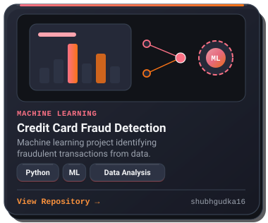
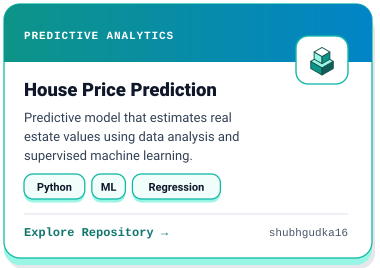
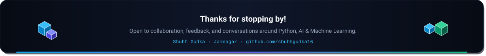

  

    

  
  &nbsp;&nbsp;
  
  &nbsp;&nbsp;
  

 

## 👨‍💻 About Me

I’m a final-year **Computer Engineering Diploma student** based in **Jamnagar**, focused on building practical software and learning how data and machine learning solve real-world problems.

  

 

## 🛠️ Technology Stack

  

 

## 📌 Featured Projects

<table>
  <tr>
    <td width="33.33%" align="center">
      
    </td>
    <td width="33.33%" align="center">
      
    </td>
    <td width="33.33%" align="center">
      
    </td>
  </tr>
</table>

 

## 📊 GitHub Analytics

  
  &nbsp;
  

 

## 🤝 Let’s Connect

  

