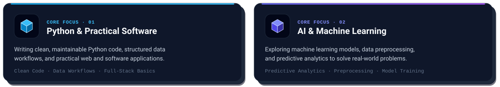
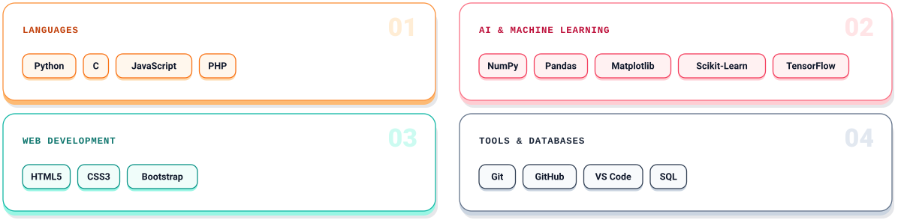
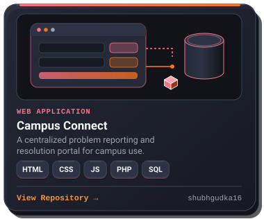

  

    

  
  &nbsp;&nbsp;&nbsp;
  
  &nbsp;&nbsp;&nbsp;
  

 

## 👨‍💻 About Me

I’m a final-year **Computer Engineering Diploma student** based in **Jamnagar**, focused on building practical software and learning how data and machine learning solve real-world problems.

- **Python & Software Development** — writing clean code, structured data workflows, and practical applications.
- **AI, Machine Learning & Data Science** — exploring machine learning models, data preprocessing, and predictive analytics.

  

 

## 🛠️ Technology Stack

  

 

## 📌 Featured Projects

<table>
  <tr>
    <td width="33.33%" align="center">
      
    </td>
    <td width="33.33%" align="center">
      
    </td>
    <td width="33.33%" align="center">
      
    </td>
  </tr>
</table>

 

## 📊 GitHub Analytics

  
  &nbsp;
  

 

## 🤝 Let’s Connect

Feel free to reach out for collaboration, feedback, or conversations around **Python**, **AI & Machine Learning**, and **Software Development**.

- **Email:** [shubhgudka66@gmail.com](mailto:shubhgudka66@gmail.com)
- **LinkedIn:** [shubh-gudka](https://www.linkedin.com/in/shubh-gudka-473b732b3)
- **GitHub:** [shubhgudka16](https://github.com/shubhgudka16)

 

  

